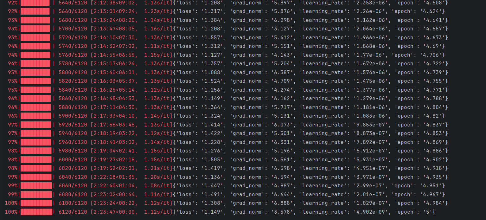
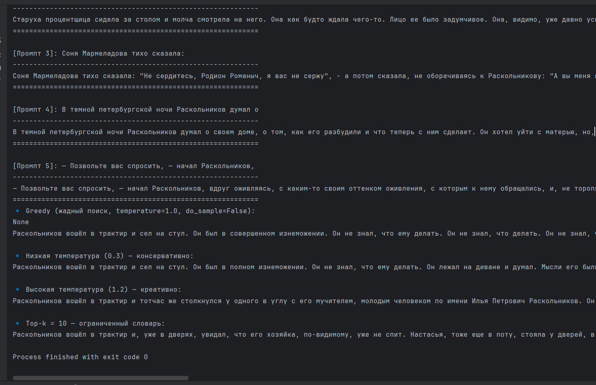

# Лабораторная работа №3  
## Разработка модели генерации текста по датасету романа Ф. М. Достоевского «Преступление и наказание»

---

## 1. Цель работы

Целью данной лабораторной работы является разработка модели генерации текста на основе выбранного текстового датасета.

В качестве датасета используется роман Ф. М. Достоевского **«Преступление и наказание»**.  
Модель дообучается на тексте романа и затем генерирует продолжения фраз в стиле Достоевского.

---

## 2. Используемая модель

В работе используется предобученная русскоязычная языковая модель:

```python
model_name = "ai-forever/rugpt3small_based_on_gpt2"
```

Это модель семейства GPT-2 / ruGPT-3 Small, обученная на русских текстах.

### Почему выбрана эта модель

- модель хорошо работает с русским языком;
- доступна через библиотеку `transformers`;
- может быть дообучена на собственном текстовом датасете;
- подходит для лабораторной работы без необходимости обучать большую модель с нуля.

---

## 3. Используемые библиотеки

В начале программы импортируются необходимые библиотеки:

```python
import torch
import re
from transformers import GPT2Tokenizer, GPT2LMHeadModel, Trainer, TrainingArguments
from datasets import Dataset

```

### Объяснение импортов

| Библиотека / модуль | Назначение |
|---|---|
| `torch` | Библиотека PyTorch. Используется для работы с нейронной моделью, тензорами и генерацией текста |
| `re` | Модуль регулярных выражений. Используется для очистки и предобработки текста |
| `GPT2Tokenizer` | Токенизатор GPT-2. Преобразует текст в числовые токены |
| `GPT2LMHeadModel` | GPT-модель для генерации текста |
| `Trainer` | Класс из Hugging Face, который упрощает обучение модели |
| `TrainingArguments` | Класс для настройки параметров обучения |
| `Dataset` | Класс из библиотеки `datasets` для хранения и обработки датасета |

---

## 4. Загрузка датасета

Текст романа загружается из локального файла:

```python
with open('prestuplenie_i_nakazanie.txt', 'r', encoding='utf-8') as f:
     full_text = f.read()
```

### Объяснение

```python
open('prestuplenie_i_nakazanie.txt', 'r', encoding='utf-8')
```

| Параметр | Значение | Объяснение |
|---|---|---|
| `'prestuplenie_i_nakazanie.txt'` | имя файла | Файл должен находиться в той же папке, что и запускаемый Python-скрипт |
| `'r'` | режим чтения | Файл открывается только для чтения |
| `encoding='utf-8'` | кодировка | Используется для корректного чтения русского текста |

Команда:

```python
full_text = f.read()
```

считывает весь текст романа в одну строковую переменную `full_text`.

---

## 5. Предобработка текста

Перед обучением текст необходимо очистить и разбить на фрагменты.

```python
def clean_and_split(text, min_length=50):
    text = re.sub(r'\n{2,}', '\n', text)
    paragraphs = [p.strip() for p in text.split('\n') if len(p.strip()) >= min_length]
    return paragraphs
```

### Назначение функции

Функция `clean_and_split` выполняет две задачи:

1. очищает текст от лишних переносов строк;
2. разбивает текст на абзацы;
3. отбрасывает слишком короткие фрагменты.

---

### Параметры функции `clean_and_split`

| Параметр | Значение по умолчанию | Объяснение |
|---|---|---|
| `text` | отсутствует | Исходный текст романа |
| `min_length` | `50` | Минимальная длина абзаца в символах. Абзацы короче этого значения не попадают в датасет |

---

### Очистка переносов строк

```python
text = re.sub(r'\n{2,}', '\n', text)
```

Эта строка заменяет два и более подряд идущих переноса строки на один перенос.

#### Разбор регулярного выражения

| Элемент | Значение |
|---|---|
| `\n` | символ переноса строки |
| `{2,}` | два или более повторений |
| `r'\n{2,}'` | регулярное выражение для поиска нескольких пустых строк |
| `'\n'` | замена на один перенос строки |

---

### Разбиение текста на абзацы

```python
paragraphs = [p.strip() for p in text.split('\n') if len(p.strip()) >= min_length]
```

Здесь используется списковое включение.

#### Что происходит по шагам

1. `text.split('\n')` — разбивает текст на строки / абзацы.
2. `p.strip()` — удаляет лишние пробелы в начале и конце абзаца.
3. `len(p.strip()) >= min_length` — проверяет, достаточно ли длинный абзац.
4. В итоговый список попадают только длинные абзацы.

---

### Вызов функции

```python
raw_texts = clean_and_split(full_text, min_length=80)
```

В данном случае минимальная длина абзаца **80 символов**.

Это означает, что слишком короткие строки, например отдельные реплики или служебные строки, будут удалены.

---

### Вывод информации о датасете

```python
print(f"Всего абзацев в датасете: {len(raw_texts)}")
print(f"Пример первого абзаца:\n{raw_texts[0][:200]}...")
```


---

## 6. Создание объекта Dataset

После предобработки текст преобразуется в объект `Dataset`.

```python
dataset = Dataset.from_dict({"text": raw_texts})
```

### Объяснение

`Dataset.from_dict()` создаёт датасет из словаря.

```python
{"text": raw_texts}
```

| Ключ | Значение |
|---|---|
| `"text"` | название колонки в датасете |
| `raw_texts` | список очищенных абзацев романа |

Таким образом, каждый пример датасета — это один абзац романа.

---

## 7. Разделение на обучающую и тестовую выборки

```python
dataset = dataset.train_test_split(test_size=0.1, seed=42)
```

### Назначение

Датасет делится на две части:

- обучающую выборку;
- тестовую выборку.

Обучающая выборка используется для настройки весов модели.  
Тестовая выборка используется для проверки качества модели на данных, которые она не видела при обучении.

---

### Параметры `train_test_split`

| Параметр | Значение | Объяснение |
|---|---|---|
| `test_size` | `0.1` | 10% данных отправляется в тестовую выборку |
| `seed` | `42` | Фиксирует случайность, чтобы разделение каждый раз было одинаковым |

Если всего в датасете 2721 абзац, то примерно:

- 2448 абзацев — обучение;
- 273 абзаца — тестирование.

---

## 8. Загрузка токенизатора

```python
model_name = "ai-forever/rugpt3small_based_on_gpt2"
tokenizer = GPT2Tokenizer.from_pretrained(model_name)
```

### Что такое токенизатор

Нейронная сеть не работает напрямую с текстом.  
Сначала текст преобразуется в числа — токены.

---

### Параметр `model_name`

```python
model_name = "ai-forever/rugpt3small_based_on_gpt2"
```

Этот параметр указывает, какую модель и токенизатор загружать из Hugging Face.

---

## 9. Настройка pad_token

```python
tokenizer.pad_token = tokenizer.eos_token
```

### Зачем это нужно

У GPT-2 обычно нет отдельного специального токена для паддинга.

**Паддинг** — это выравнивание коротких последовательностей до одинаковой длины.


Чтобы объединить примеры в батч, короткие последовательности называются специальным токеном.

В данном коде в качестве `pad_token` используется `eos_token`.

| Токен | Значение |
|---|---|
| `pad_token` | токен названия |
| `eos_token` | токен конца последовательности |

---

## 10. Параметр MAX_LENGTH

```python
MAX_LENGTH = 128
```

### Назначение

`MAX_LENGTH` задаёт максимальную длину одного обучающего примера в токенах.

Если абзац длиннее 128 токенов — он обрезается.  
Если короче — обрезается до 128 токенов.

---

## 11. Функция токенизации

```python
def tokenize_function(examples):
    outputs = tokenizer(
        examples["text"],
        padding="max_length",
        truncation=True,
        max_length=MAX_LENGTH,
        return_special_tokens_mask=False
    )
    outputs["labels"] = outputs["input_ids"].copy()
    return outputs
```

### Назначение функции

Функция `tokenize_function` преобразует текстовые абзацы в числовые последовательности, которые можно передать в модель.

---

### Параметр `examples`

```python
examples
```

Это пакет примеров из датасета.

Так как токенизация запускается с параметром `batched=True`, в функцию передаётся не один текст, а сразу группа текстов.

---

### Вызов токенизатора

```python
outputs = tokenizer(
    examples["text"],
    padding="max_length",
    truncation=True,
    max_length=MAX_LENGTH,
    return_special_tokens_mask=False
)
```

---

### Параметры токенизатора

| Параметр | Значение | Объяснение |
|---|---|---|
| `examples["text"]` | список абзацев | Тексты, которые нужно токенизировать |
| `padding` | `"max_length"` |Обрезает все последовательности до длины `MAX_LENGTH` |
| `truncation` | `True` | Обрезает слишком длинные тексты |
| `max_length` | `MAX_LENGTH`, то есть `128` | Максимальная длина последовательности |
| `return_special_tokens_mask` | `False` | Не возвращает отдельную маску специальных токенов |

---

### Что возвращает токенизатор

Обычно токенизатор возвращает словарь:

```python
{
    "input_ids": [...],
    "attention_mask": [...]
}
```

| Поле | Объяснение |
|---|---|
| `input_ids` | числовые идентификаторы токенов |
| `attention_mask` | маска внимания: 1 — настоящий токен, 0 — padding |

---

## 12. Создание labels

```python
outputs["labels"] = outputs["input_ids"].copy()
```

### Зачем нужны labels

Для обучения языковой модели нужны:

1. входные токены;
2. правильные ответы, то есть `labels`.

В задаче генерации текста модель учится предсказывать следующий токен.

---

## 13. Применение токенизации к датасету

```python
tokenized_datasets = dataset.map(
    tokenize_function,
    batched=True,
    remove_columns=["text"]
)
```

### Назначение

Метод `.map()` применяет функцию токенизации ко всем элементам датасета.

---

### Параметры `.map()`

| Параметр | Значение | Объяснение |
|---|---|---|
| `tokenize_function` | функция | Функция, которая обрабатывает тексты |
| `batched` | `True` | Обработка выполняется пачками, что быстрее |
| `remove_columns` | `["text"]` | Удаляет исходную текстовую колонку после токенизации |

После токенизации в датасете остаются только числовые поля:

- `input_ids`;
- `attention_mask`;
- `labels`.

---

## 14. Загрузка модели

```python
model = GPT2LMHeadModel.from_pretrained(model_name)
```

### Объяснение

Загружается предобученная GPT-модель для задачи генерации текста.

`GPT2LMHeadModel` состоит из:

1. трансформерного блока GPT-2;
2. языковой головы `LM Head`, которая предсказывает следующий токен.

---

## 15. Настройка параметров обучения

```python
training_args = TrainingArguments(
    output_dir="./dostoevsky_rugpt",
    per_device_train_batch_size=2,
    per_device_eval_batch_size=2,
    num_train_epochs=5,
    learning_rate=3e-5,
    weight_decay=0.01,
    logging_steps=20,
    save_strategy="epoch",
    eval_strategy="epoch",
    load_best_model_at_end=True,
    metric_for_best_model="eval_loss",
    greater_is_better=False,
    report_to="none",
    fp16=torch.cuda.is_available()
)
```

---

## 16. Подробное объяснение TrainingArguments

| Параметр | Значение | Объяснение |
|---|---|---|
| `output_dir` | `"./dostoevsky_rugpt"` | Папка, куда сохраняются веса модели и результаты обучения |
| `per_device_train_batch_size` | `2` | Количество примеров в одном батче при обучении на одном устройстве |
| `per_device_eval_batch_size` | `2` | Количество примеров в батче при проверке модели |
| `num_train_epochs` | `5` | Количество полных проходов по обучающему датасету |
| `learning_rate` | `3e-5` | Скорость обучения. Определяет, насколько сильно обновляются веса модели |
| `weight_decay` | `0.01` | Регуляризация, которая помогает уменьшить переобучение |
| `logging_steps` | `20` | Каждые 20 шагов выводится информация о loss |
| `save_strategy` | `"epoch"` | Модель сохраняется после каждой эпохи |
| `eval_strategy` | `"epoch"` | Проверка на тестовой выборке выполняется после каждой эпохи |
| `load_best_model_at_end` | `True` | После обучения загружается лучшая модель |
| `metric_for_best_model` | `"eval_loss"` | Лучшая модель выбирается по минимальному значению ошибки на тестовой выборке |
| `greater_is_better` | `False` | Чем меньше `eval_loss`, тем лучше |
| `report_to` | `"none"` | Отключает отправку логов во внешние сервисы |
| `fp16` | `torch.cuda.is_available()` | Использует смешанную точность, если доступна CUDA-видеокарта |

---

### Что такое batch size

```python
per_device_train_batch_size=2
```

Batch size — это количество примеров, которые модель обрабатывает одновременно.

---

### Что такое epoch

```python
num_train_epochs=5
```

Одна эпоха — это один полный проход модели по всему обучающему датасету.


### Что такое learning_rate

```python
learning_rate=3e-5
```

`learning_rate` определяет величину изменения весов модели на каждом шаге.

Для дообучения больших языковых моделей обычно используются маленькие значения learning rate, чтобы не разрушить уже выученные языковые закономерности.

---

### Что такое weight_decay

```python
weight_decay=0.01
```

Это коэффициент регуляризации.  
Он помогает бороться с переобучением, когда модель слишком сильно запоминает обучающий текст и хуже работает с новыми промптами.

---

### Что такое fp16

```python
fp16=torch.cuda.is_available()
```

Если CUDA доступна, включается режим смешанной точности `fp16`.

Это ускоряет обучение на NVIDIA GPU и уменьшает расход видеопамяти.

---

## 17. Создание Trainer

```python
trainer = Trainer(
    model=model,
    args=training_args,
    train_dataset=tokenized_datasets["train"],
    eval_dataset=tokenized_datasets["test"]
)
```

### Назначение Trainer

`Trainer` автоматически выполняет:

- загрузку батчей;
- прямой проход модели;
- вычисление loss;
- обратное распространение ошибки;
- обновление весов;
- логирование;
- оценку модели;
- сохранение чекпоинтов.

---

### Параметры Trainer

| Параметр | Значение | Объяснение |
|---|---|---|
| `model` | `model` | Обучаемая GPT-модель |
| `args` | `training_args` | Настройки обучения |
| `train_dataset` | `tokenized_datasets["train"]` | Обучающая выборка |
| `eval_dataset` | `tokenized_datasets["test"]` | Тестовая выборка |

---

## 18. Запуск обучения

```python
print("ачинаем дообучение на романе Достоевского...")
trainer.train()
print("Обучение завершено!")
```

### Что происходит во время обучения

На каждом шаге:

1. модель получает батч токенов;
2. предсказывает следующие токены;
3. сравнивает предсказания с правильными токенами;
4. вычисляет `loss`;
5. обновляет веса.

---

### Пример логов обучения



---

## 19. Анализ loss

`loss` — это значение функции потерь.  
Оно показывает, насколько сильно модель ошибается при предсказании следующего токена.

Чем меньше loss, тем лучше модель предсказывает текст обучающего распределения.

---


```markdown

```

---

## 20. Функция генерации текста

После обучения определяется функция:

```python
def generate(prompt, max_new_tokens=150, temperature=0.85, top_k=50, top_p=0.92):
    inputs = tokenizer(prompt, return_tensors="pt").to(model.device)
    with torch.no_grad():
        outputs = model.generate(
            **inputs,
            max_new_tokens=max_new_tokens,
            temperature=temperature,
            top_k=top_k,
            top_p=top_p,
            do_sample=True,
            no_repeat_ngram_size=3,
            pad_token_id=tokenizer.eos_token_id
        )
    return tokenizer.decode(outputs[0], skip_special_tokens=True)
```

---

## 21. Параметры функции generate

| Параметр | Значение по умолчанию | Объяснение |
|---|---|---|
| `prompt` | отсутствует | Начальная фраза, которую модель должна продолжить |
| `max_new_tokens` | `150` | Максимальное количество новых токенов, которые модель сгенерирует |
| `temperature` | `0.85` | Управляет случайностью генерации |
| `top_k` | `50` | Ограничивает выбор следующими токенами из 50 наиболее вероятных |
| `top_p` | `0.92` | Nucleus sampling: выбирает токены с суммарной вероятностью до 0.92 |

---

### Токенизация промпта

```python
inputs = tokenizer(prompt, return_tensors="pt").to(model.device)
```

| Параметр | Значение | Объяснение |
|---|---|---|
| `prompt` | строка | Текст, который нужно продолжить |
| `return_tensors` | `"pt"` | Возвращает PyTorch-тензоры |
| `.to(model.device)` | устройство модели | Переносит входные данные на CPU или GPU, где находится модель |

---

### Отключение градиентов

```python
with torch.no_grad():
```

Во время генерации обучение не требуется.  
Поэтому градиенты отключаются для ускорения работы и экономии памяти.

---

## 22. Параметры model.generate

```python
outputs = model.generate(
    **inputs,
    max_new_tokens=max_new_tokens,
    temperature=temperature,
    top_k=top_k,
    top_p=top_p,
    do_sample=True,
    no_repeat_ngram_size=3,
    pad_token_id=tokenizer.eos_token_id
)
```

| Параметр | Значение | Объяснение |
|---|---|---|
| `**inputs` | токены промпта | Передаёт `input_ids` и `attention_mask` в модель |
| `max_new_tokens` | `150` | Сколько новых токенов сгенерировать |
| `temperature` | `0.85` | Чем выше значение, тем более случайная генерация |
| `top_k` | `50` | Выбор только из 50 наиболее вероятных токенов |
| `top_p` | `0.92` | Выбор из набора токенов, суммарная вероятность которых не превышает 0.92 |
| `do_sample` | `True` | Включает случайную генерацию |
| `no_repeat_ngram_size` | `3` | Запрещает повторение одинаковых триграмм |
| `pad_token_id` | `tokenizer.eos_token_id` | Указывает токен padding для генерации |

---

### Temperature

Температура влияет на разнообразие текста.

| Температура | Поведение модели |
|---:|---|
| `0.3` | Более предсказуемый и осторожный текст |
| `0.85` | Баланс между связностью и разнообразием |
| `1.2` | Более случайный и креативный текст, возможны ошибки |

---

### Top-k

```python
top_k=50
```

Модель выбирает следующий токен только среди 50 наиболее вероятных вариантов.

Это уменьшает вероятность появления совсем случайных слов.

---

### Top-p

```python
top_p=0.92
```

Используется nucleus sampling.

Модель выбирает не фиксированное количество токенов, а минимальный набор токенов, суммарная вероятность которых составляет 92%.

---

### no_repeat_ngram_size

```python
no_repeat_ngram_size=3
```

Запрещает повторять одинаковые последовательности из трёх токенов.

Это помогает бороться с зацикливанием текста, например:

```text
он думал о том что он думал о том что он думал...
```

---

## 23. Декодирование результата

```python
return tokenizer.decode(outputs[0], skip_special_tokens=True)
```

### Объяснение

Модель возвращает токены.  
Чтобы получить обычный текст, они преобразуются обратно через токенизатор.

| Параметр | Значение | Объяснение |
|---|---|---|
| `outputs[0]` | первая сгенерированная последовательность | Берём первый результат из батча |
| `skip_special_tokens` | `True` | Не выводит служебные токены |

---

## 24. Промпты для генерации

```python
prompts = [
    "Раскольников вышел из своей каморки и",
    "Старуха процентщица сидела за столом и",
    "Соня Мармеладова тихо сказала:",
    "В темной петербургской ночи Раскольников думал о",
    "— Позвольте вас спросить, — начал Раскольников,"
]
```

---

## 25. Цикл генерации

```python
for i, p in enumerate(prompts, 1):
    print(f"\n[Промпт {i}]: {p}")
    print("-" * 60)
    result = generate(p)
    print(result)
    print("=" * 60)
```

### Объяснение

| Элемент | Назначение |
|---|---|
| `enumerate(prompts, 1)` | Перебирает промпты с нумерацией от 1 |
| `generate(p)` | Генерирует продолжение текущего промпта |
| `print(result)` | Выводит результат в консоль |

---

## 26. Результаты генерации



---

### Промпт 1

```text
Раскольников вышел из своей каморки и
```

#### Сгенерированный текст


```text
Раскольников вышел из своей каморки и подошел к окну. Она стояла на подоконнике, закрыв глаза и опустив голову, и смотрела в окно, где на подоконниках, на красных осенних листках, на маленьких белках, пляшут маленькие красные кружочки, и в этом последнем, последнем взгляде она была как бы в самом деле счастлива. Он пошел ей навстречу. Она взглянула на него внимательно и с любовью. Он прошел в комнату, остановился в углу, посмотрел кругом и вдруг вдруг, точно припоминая, крикнул: "Эх! Опять забыл!" Она вскочила с постели и схватила его за плечо. Он смотрел на нее и молчал. Она поняла, что он уже знает, что ей надо делать. В одно мгновение она была совсем уверена, что вот-вот и ее уже нет.
```

---

### Промпт 2

```text
Старуха процентщица сидела за столом и
```

#### Сгенерированный текст

```text
Старуха процентщица сидела за столом и молча смотрела на него. Она как будто ждала чего-то. Лицо ее было задумчивое. Она, видимо, уже давно успела привыкнуть к мысли, что у всех на уме одно только одно слово, и это был тот самый взгляд, которым только что смотрела старуха на нее. Он подошел к ней и сел на стул. Она глядела на него с каким-то удивлением и с удивлением. Она всё больше и больше убеждалась, что он не ошибся с ее собственным мнением. Она опять поняла, что она еще ни в чем не могла так ошибиться. Он встал и пошел в свою комнату. Ей показалось, что даже в нем мелькнула какая-то решимость. Она подняла голову и посмотрела в его лицо. Он сел на стуле и улыбнулся ей. Ее охватил новый
```

---

### Промпт 3

```text
Соня Мармеладова тихо сказала:
```

#### Сгенерированный текст

```text
Соня Мармеладова тихо сказала: "Не сердитесь, Родион Романыч, я вас не сержу", - а потом сказала, не оборачиваясь к Раскольникову: "А вы меня извините, что я здесь буду говорить", - и ушла. Потом, не сказав больше ни слова, вышла из комнаты. Идя по улице, она не понимала, что с ней делают, и что это делают. Она шла себе и смотрела на прохожих, не замечая их. И как-то вдруг поняла, что ей уже всё равно, и не может больше жить. "Не то!" - подумала она. Она остановилась. "Пойду!" - сказал он. Она пошла назад. Она обернулась и пошла к дому. И стала подниматься по лестнице. Но она уже поняла, в каком
```

---

### Промпт 4

```text
В темной петербургской ночи Раскольников думал о
```

#### Сгенерированный текст

```text
В темной петербургской ночи Раскольников думал о своем доме, о том, как его разбудили и что теперь с ним сделает. Он хотел уйти с матерью, но, придя в острог, ему вдруг показалось, что, может быть, уже и не надо ему оставаться в остроге, и что он уже и забыл о квартире. Вдруг он узнал, что живет в доме Раскольникова, в котором когда-то был помещен его отец. Он узнал и о доме Расторгуева, который тоже был помещиком и что его отец умер в остряке в 1860 г. от побоев. Он вспомнил, как он шел домой и вдруг, не глядя, пошел прямо по направлению к дому. Он пошел прямо на улицу, и, не останавливаясь, пошел к дому Порфи
```


---

### Промпт 5

```text
— Позвольте вас спросить, — начал Раскольников,
```

#### Сгенерированный текст

```text
— Позвольте вас спросить, — начал Раскольников, вдруг оживляясь, с каким-то своим оттенком оживления, с которым к нему обращались, и, не торопясь, как бы даже с самым любопытством, продолжал: - Ведь вы сами изволили меня знать, что вы не совсем еще изволите знать... А вы, стало быть, не могли не знать, кто я такой и почему меня так настойчиво зовете? Ну что ж, и я вас могу убедить... Мне это всё кажется странным, как-то странным... А как я вам теперь скажу? Я как-нибудь зайду к вам... я знаю... Ну, в самом деле: ведь я-то вас убил? - обратился он к Порфирию, совсем не отводя своего любопытного, проницательного взгляда от его лица
```

---

## 27. Сравнение стратегий генерации

В коде выполняется сравнение нескольких режимов генерации на одном промпте:

```python
prompt = "Раскольников вошёл в трактир и"
```

---

### 27.1. Жадная генерация Greedy

```python
out = model.generate(
    **inputs,
    max_new_tokens=120,
    do_sample=False,
    pad_token_id=tokenizer.eos_token_id
)
```

### Объяснение

При `do_sample=False` модель каждый раз выбирает самый вероятный следующий токен.

Преимущества:

- текст более предсказуемый;
- меньше случайных ошибок.

Недостатки:

- возможны повторы;
- текст может быть однообразным.

---

#### Результат Greedy

```text
Раскольников вошёл в трактир и сел на стул. Он был в совершенном изнеможении. Он не знал, что ему делать. Он не знал, что делать. Он не знал, что делать. Он не знал, что делать. Он не знал, что делать. Он не знал, что делать. Он не знал, что делать. Он не знал, что делать. Он не знал, что делать. Он не знал, что делать. Он не знал, что делать. Он не знал, что делать. Он не знал, что делать. Он не знал, что делать. Он не знал, что делать. Он
```

---

### 27.2. Низкая температура

```python
generate(prompt, temperature=0.3)
```

### Объяснение

Низкая температура делает модель более осторожной.

Ожидаемый результат:

- связный текст;
- меньше неожиданных слов;
- possible повторы.

---

#### Результат temperature = 0.3

```text
Раскольников вошёл в трактир и сел на стул. Он был в полном изнеможении. Он не знал, что ему делать. Он лежал на диване и думал. Мысли его были полны какого-то нового, нового, неожиданного, нового ощущения. Он вспомнил, что он, может быть, уже и не в первый раз в жизни, и что, может, уже давно уже не в последний раз он видел его. Он чувствовал, что всё это время, с первого взгляда, он не мог ни о чем думать. Он знал, он знал, как ему тяжело и тяжело, и как он хочет облегчить свою участь. Он хотел было что-то сказать, но не мог. Он смотрел на Разумихина, и ему вдруг стало вдруг ужасно тяжело. Он встал, подошел к
```

---

### 27.3. Высокая температура

```python
generate(prompt, temperature=1.2)
```

### Объяснение

Высокая температура увеличивает случайность.

Ожидаемый результат:

- более разнообразные фразы;
- больше неожиданных слов;
- возможны смысловые ошибки.

---

#### Результат temperature = 1.2

```text
Раскольников вошёл в трактир и тотчас же столкнулся у одного в углу с его мучителем, молодым человеком по имени Илья Петрович Раскольников. Он внимательно поглядел на своего посетителя. Под рукой у него лежал лист бумаги. Стараниями какого-то пьяного юноши он развязал узел с рубашечками и выложил все пачки, полученные ими за полтора года. Затем, отдуваясь и вытирая пот, он вдруг узнал, что, в сущности, он теперь не из какого-нибудь заведения, а из третьего квартала, на углу с Большой Морской. Денег у него было двадцать три рубля. Затем еще немного времени они разговаривали, но уже не заметили Раскольникова. Тот сел на диван, взял бумажку и стал было рассказывать всё, что случилось. Сознавшись, что он
```

---

### 27.4. Top-k = 10

```python
generate(prompt, top_k=10)
```

### Объяснение

Модель выбирает следующий токен только из 10 наиболее вероятных вариантов.

Ожидаемый результат:

- меньше случайных слов;
- более безопасная генерация;
- текст может стать менее разнообразным.

---

#### Результат top_k = 10

```text
Раскольников вошёл в трактир и, уже в дверях, увидал, что его хозяйка, по-видимому, уже не спит. Настасья, тоже еще в поту, стояла у дверей, в то время как Разумихин, по крайней мере, еще не проснулся. Разумихину показалось, что она и сама уже не знает, как ей лучше поступить. Разумехин, в свою очередь, не спал, он слышал, что Раскольников говорил. Он знал, что Разумихина уже нет дома, но, как и в первый раз, он вдруг вспомнил, что надо уходить, и пошел назад. Он хотел было что-то сказать, но не мог. Он остановился на пороге. Дверь отпертая, но он успел ее захлопнуть и не отво
```

---


