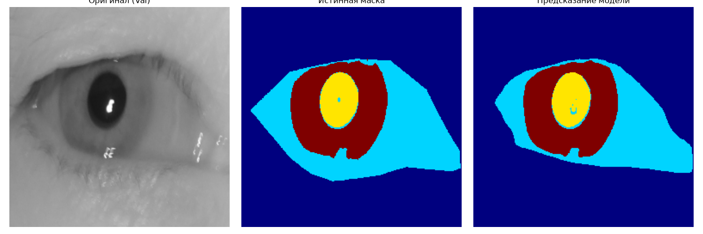
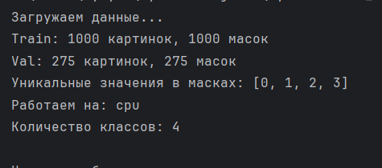

---

# Отчёт по лабораторной работе: Семантическая сегментация изображений глаза с использованием U-Net

## 1. Цель работы
Разработка, реализация и обучение модели глубокого обучения для задачи семантической сегментации изображений глаза с целью попиксельного выделения ключевых анатомических структур: зрачка, радужной оболочки и склеры.

## 2. Используемые инструменты и библиотеки
- **Язык программирования:** Python 3.x
- **Фреймворк глубокого обучения:** PyTorch
- **Библиотека моделей:** `segmentation_models_pytorch` (SMP)
- **Обработка изображений:** OpenCV (`cv2`), NumPy
- **Визуализация:** Matplotlib

## 3. Описание датасета
Для обучения использован локальный датасет `IRIS + PUPIL + EYE`.
- **Объём данных:** 
  - Обучающая выборка (Train): 1000 пар изображение-маска.
  - Валидационная выборка (Val): 275 пар изображение-маска.
- **Структура:** Изображения и маски хранятся в раздельных директориях (`image` и `segmentation`), имена файлов строго совпадают.
- **Классы сегментации:** Анализ тензоров масок выявил 4 уникальных значения пикселей: `[0, 1, 2, 3]`, что соответствует:
  - `0`: Фон
  - `1`: Склера (белок глаза)
  - `2`: Радужная оболочка (Iris)
  - `3`: Зрачок (Pupil)

---

## 4. Реализация и объяснение кода

### 4.1. Загрузка и предобработка данных
Для чтения данных написана кастомная функция, которая обходит папки и попарно загружает изображения и маски.

```python
def load_data(split_folder):
    images_list, masks_list = [], []
    img_dir = os.path.join(split_folder, "image")
    seg_dir = os.path.join(split_folder, "segmentation")

    for filename in os.listdir(img_dir):
        if filename.endswith('.png'):
            # 1. Чтение и подготовка изображения
            img = cv2.imread(os.path.join(img_dir, filename))
            img = cv2.cvtColor(img, cv2.COLOR_BGR2RGB) # Конвертация в RGB для корректного отображения
            img = cv2.resize(img, (256, 256))          # Приведение к единому размеру
            images_list.append(img)
            
            # 2. Чтение и подготовка маски
            mask = cv2.imread(os.path.join(seg_dir, filename), cv2.IMREAD_GRAYSCALE)
            # ВАЖНО: Для масок используется INTER_NEAREST, чтобы не создавать "смешанные" 
            # промежуточные значения пикселей (например, 1.5) на границах объектов
            mask = cv2.resize(mask, (256, 256), interpolation=cv2.INTER_NEAREST)
            masks_list.append(mask)
            
    return images_list, masks_list
```
 Использование `cv2.INTER_NEAREST` для масок является критически важным. Обычная интерполяция (билинейная) размывает границы, превращая чёткие классы `1, 2, 3` в дробные числа, что ломает функцию потерь.

### 4.2. Преобразование в тензоры PyTorch
```python
# Перестановка осей из формата OpenCV (H, W, C) в формат PyTorch (C, H, W)
# и нормализация пикселей к диапазону [0, 1]
X_train = torch.tensor(np.array(train_images)).permute(0, 3, 1, 2).float() / 255.0
y_train = torch.tensor(np.array(train_masks)).long() # Маски должны быть целочисленными (Long)
```
 Сверточные слои PyTorch ожидают входные данные в формате `[Batch, Channels, Height, Width]`. Метод `.permute(0, 3, 1, 2)` меняет оси местами. Нормализация делением на 255.0 ускоряет сходимость градиентного спуска.

### 4.3. Инициализация модели
```python
device = torch.device('cuda' if torch.cuda.is_available() else 'cpu')

model = smp.Unet(
    encoder_name="resnet18",        # Легкий и быстрый энкодер
    encoder_weights="imagenet",     # Загрузка предобученных весов для ускорения сходимости
    in_channels=3,                  # 3 цветовых канала (RGB)
    classes=4                       # 4 класса сегментации
).to(device)
```
 Архитектура U-Net идеально подходит для сегментации благодаря *skip-connections* (пропускающим связям), которые передают детали с ранних слоев энкодера напрямую в декодер, сохраняя чёткость границ зрачка и радужки.

### 4.4. Цикл обучения (Training Loop)
```python
criterion = torch.nn.CrossEntropyLoss() # Функция потерь для многоклассовой классификации
optimizer = torch.optim.Adam(model.parameters(), lr=0.001)

for epoch in range(epochs):
    model.train() # Включаем режим обучения (активируем Dropout и BatchNorm)
    train_loss = 0
    
    for batch_x, batch_y in train_loader:
        batch_x, batch_y = batch_x.to(device), batch_y.to(device)
        
        optimizer.zero_grad()               # 1. Обнуляем градиенты от предыдущего шага
        predictions = model(batch_x)        # 2. Прямой проход (Forward pass)
        loss = criterion(predictions, batch_y) # 3. Вычисление ошибки
        loss.backward()                     # 4. Обратное распространение ошибки (Backward pass)
        optimizer.step()                    # 5. Обновление весов модели
        
        train_loss += loss.item()
```
 Стандартный и наиболее эффективный паттерн обучения в PyTorch. Использование `train_loader` с `batch_size=8` позволяет модели обновлять веса на основе небольших пакетов данных, что экономит память и стабилизирует обучение.

### 4.5. Визуализация результатов
```python
model.eval() # Режим оценки (отключает Dropout)
with torch.no_grad(): # Отключаем вычисление градиентов для экономии памяти и ускорения
    test_img = X_val[0:1].to(device)
    true_mask = y_val[0].cpu().numpy()
    
    pred = model(test_img)
    # argmax(dim=1) выбирает индекс класса с максимальной вероятностью для каждого пикселя
    pred_mask = pred.argmax(dim=1).squeeze().cpu().numpy()
```
 Модель выдаёт "логиты" (сырые числа) размером `[1, 4, 256, 256]`. Метод `.argmax(dim=1)` схлопывает каналы классов, оставляя для каждого пикселя только номер класса (0, 1, 2 или 3), который модель считает наиболее вероятным.

---

## 5. Результаты обучения





---
